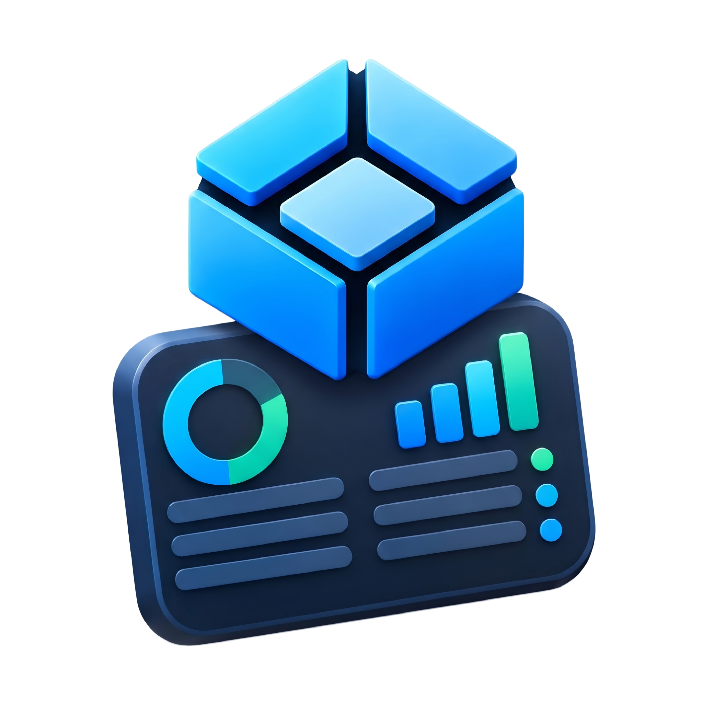

<div align="center">



# NAS Dash

[](https://developer.android.com) [](https://flutter.dev) [](https://github.com/mina-android/NAS-Dash/releases) [](https://www.truenas.com) [](LICENSE)

<p align="center">
  A native Android dashboard and management client for TrueNAS SCALE servers, providing real-time hardware telemetry, read-only ZFS storage inspection, containerized application lifecycle controls, Wake-on-LAN recovery, and encrypted remote routing.
</p>

</div>

---

## Navigation

[Features](#features) &bull; [Downloads](#downloads) &bull; [Self Building & Local Setup](#self-building--local-setup) &bull; [Frequently Asked Questions](#frequently-asked-questions) &bull; [Contribution](#contribution) &bull; [About the Developer](#about-the-developer) &bull; [Donate](#donate) &bull; [License](#license)

---

## Features

### Core Capabilities

- **Real-Time Telemetry & Hardware Monitoring**: Streams live CPU utilization, per-core temperatures, ZFS ARC and physical memory breakdowns, network interface RX/TX throughput, active system alerts with server-side dismissal/restoration, background jobs, and OS boot pool wear over `wss://` JSON-RPC 2.0 and `https://` REST v2.0 endpoints.
- **Landscape Lock & Always-On Display (AOD) Mode**: Locks orientation to landscape with `FLAG_KEEP_SCREEN_ON` wake-lock, `SystemUiMode.immersiveSticky`, a top-bar telemetry cluster (active `LAN`/`VPN` route, Android battery percentage, and clock), a full-height frosted side navigation rail, and 2-column masonry/grid layouts. After 30 seconds of inactivity on the Landscape Dashboard, it transitions to a true-black (`#000000`) OLED AOD view that dims screen brightness by 10% (90% of current brightness, `0.02` floor) and shifts pixels every 60 seconds.
- **Dynamic Server Status & Wake-on-LAN (WoL)**: Gates the main shell on live server reachability, rendering dedicated screens for **Server is Off** (after in-app shutdown), **Server is Restarting** (3-minute wall-clock countdown with auto-reconnect), and **Server Offline or Disconnected** (on unreachable cold start). Sends 102-byte UDP magic packets using auto-discovered (`/api/v2.0/interface`) or manually configured NIC MAC addresses, polling every 5 seconds for up to 3 minutes until online, alongside a 30-minute periodic LAN-first/VPN-fallback health check.
- **Customizable Dashboard Widgets**: Provides 12 modular dashboard cards with persistent visibility, ordering, compact/expanded sizing, and single-line collapse states stored in `SharedPreferences`.
- **ZFS Storage & Dataset Inspector**: Read-only inspection of ZFS pools, VDEV mirror and RAIDZ topologies, dataset compression ratios, mount points, and physical disk S.M.A.R.T. temperatures.
- **Containerized App Management**: Lists TrueNAS SCALE catalog applications with search and status filter chips (`All`, `Running`, `Stopped`, `Updates`), version upgrade differentials enriched via `/api/v2.0/app/upgrade_summary`, Start/Stop/Upgrade actions, batch **Upgrade All** execution with live `/api/v2.0/core/get_jobs` progress polling, and Web UI portal launching.
- **Dual-Endpoint Network Routing**: Probes the primary LAN host first and falls back to a secondary VPN overlay host (NetBird, Tailscale, WireGuard), rewriting app portal URLs to match the active route.
- **Biometric Guards & Host Controls**: Requires `LocalAuthentication` biometric or device PIN verification for host Reboot and Shutdown actions (including TrueNAS SCALE 25.04+ audit reason payloads), alongside SMB share toggles, username-resolved filesystem ACL inspection, host power history, and user account inspection.

### Architecture & Data Handling

- **Local-First Credential Storage**: Server profiles, API keys, and credentials remain on the Android device inside `flutter_secure_storage` (`encryptedSharedPreferences: true`, `resetOnError: true`), while UI layout preferences use `SharedPreferences`.
- **Encrypted TLS Transport & Storage Guardrails**: Enforces `https://` and `wss://` with self-signed certificate pinning (`badCertificateCallback`) so TrueNAS SCALE 25.04+ API keys are never transmitted over plaintext HTTP. Destructive pool, VDEV, dataset, and manual snapshot operations are intentionally excluded from the UI.
- **Zero Outbound Telemetry**: No analytics, crash reporters, or third-party tracking SDKs are included. Network traffic is strictly limited to configured TrueNAS hosts and optional app icon lookups.

---

## Downloads

Official release packages are published under the [GitHub Releases](https://github.com/mina-android/NAS-Dash/releases) repository page.

| Platform | Architecture | Package Type | Download Link | Notes |
| :--- | :--- | :--- | :--- | :--- |
| **Android** | arm64-v8a | `.apk` | [Download (v1.1.1)](https://github.com/mina-android/NAS-Dash/releases/latest) | Modern 64-bit devices (recommended) |
| **Android** | armeabi-v7a | `.apk` | [Download (v1.1.1)](https://github.com/mina-android/NAS-Dash/releases/latest) | Legacy 32-bit devices |
| **Android** | x86_64 | `.apk` | [Download (v1.1.1)](https://github.com/mina-android/NAS-Dash/releases/latest) | Android emulators and x86 tablets |
| **Android** | Universal | `.apk` | [Download (v1.1.1)](https://github.com/mina-android/NAS-Dash/releases/latest) | Combined installer supporting all architectures |

---

## Self Building & Local Setup

### 1. Prerequisites

Ensure your development environment has the following software installed:

- **Flutter SDK**: `3.47.6` (pinned)
- **Dart SDK**: `3.13.5` (bundled with Flutter `3.47.6`)
- **Android SDK**: API level `36` (`minSdk 26`, `targetSdk 36`)
- **Java Development Kit**: JDK `21` LTS
- **Git**: `2.30+`

### 2. Repository Setup

```bash
# Clone the repository
git clone https://github.com/mina-android/NAS-Dash.git

# Navigate into the project root
cd NAS-Dash

# Verify development environment
flutter doctor
```

### 3. Dependency Installation

```bash
# Fetch required dependencies
flutter pub get
```

### 4. Build Compilation

```bash
# Compile universal and split-per-ABI release APKs
flutter build apk --release
flutter build apk --split-per-abi
```

Compiled binaries will be generated inside `build/app/outputs/flutter-apk/`.

### 5. Running the Application Locally

```bash
# Connect a target device/emulator, then execute
flutter run --release
```

---

## Frequently Asked Questions

#### How do I generate an API key on TrueNAS SCALE?
Log into the TrueNAS SCALE Web UI, open the user menu in the upper-right corner, navigate to **API Keys**, select **Add**, and copy the generated token into the NAS Dash server configuration form.

#### Does NAS Dash work over Tailscale, NetBird, or WireGuard?
Yes. Enter your local IP under **Primary Host URL (LAN)** and your VPN IP under **Secondary Host / VPN**. NAS Dash probes the LAN host first and falls back to the VPN host automatically when away from your local network.

#### How does Wake-on-LAN know my server's MAC address?
While the server is online, NAS Dash reads the active physical NIC MAC address (`state.link_address`) from `/api/v2.0/interface` and saves it to the server profile if no MAC is set. You can also enter or override the MAC address, broadcast IP, and UDP port (default `9`) in **Edit Server Configuration**.

#### Can NAS Dash format disks or delete ZFS pools and datasets?
No. All storage views in NAS Dash are strictly read-only to prevent accidental data loss.

#### Does this application collect telemetry or connect to external servers?
No telemetry, usage metrics, or error tracking packages are included. Outbound network requests only target your configured TrueNAS SCALE hosts (plus optional app icon asset/CDN lookups).

---

## Contribution

Contributions that improve stability, fix reproducible bugs, or improve documentation are welcome.

### Contribution Process

1. **Check Issues**: Review existing GitHub Issues to verify whether a problem or enhancement is already documented.
2. **Open a Discussion**: For substantial structural or architectural alterations (or newer TrueNAS SCALE API changes), open an issue first to discuss the design.
3. **Branching**: Branch off `main` using descriptive branch names (`fix/issue-description` or `feat/feature-name`).
4. **Code Quality**:
   - Ensure code passes static analysis: `flutter analyze`
   - Run unit and widget tests: `flutter test`
5. **Pull Request**: Open a pull request against `main` providing a clear breakdown of changes and relevant issue links.

---

## About the Developer

This project is authored and maintained by **mina-android**, focused on developing transparent, local-first utilities and privacy-conscious software.

[](https://portfolio.minaashraf285.workers.dev/) [](https://github.com/mina-android) [](https://github.com/mina-android/NAS-Dash/issues)

---

## Donate

Development and maintenance of this software are independent and self-supported. If this project helps you in your workflow, consider supporting development:

[](https://paypal.me/minaashraf285) [](https://github.com/sponsors/mina-android) [](https://ko-fi.com/minaashraf285)

---

## License

Distributed under the **GNU General Public License v3.0**. See the [`LICENSE`](LICENSE) file in the root directory for the complete legal text.

```text
Copyright (c) 2026 mina-android
Licensed under the GNU General Public License v3.0.
```
