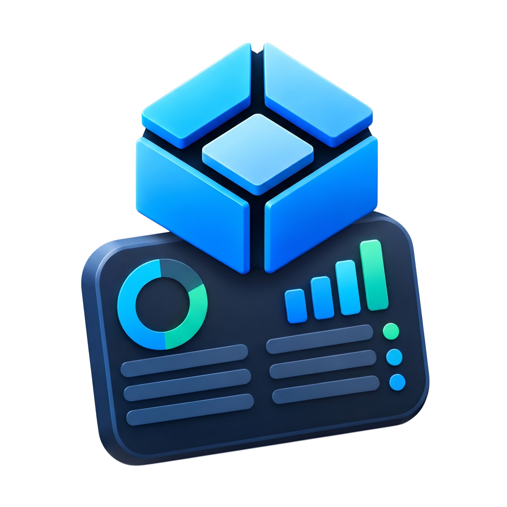

<div align="center">



<h1>NAS Dash</h1>

<h3>A modern, native Android control panel and dashboard for TrueNAS SCALE servers</h3>

[](https://android.com) [](https://github.com/mina-android/NAS-Dash/releases) [](https://www.truenas.com) [](LICENSE)

NAS Dash is a high-performance Android companion designed specifically for TrueNAS SCALE servers.  
It provides real-time hardware telemetry, customizable dashboard widgets, deep read-only ZFS storage inspection, installed app controls with smart VPN portal rewriting, and real-time Android push notifications.

[**Download**](#-download) · [**Features**](#-what-you-can-do) · [**Getting Started**](#-getting-started) · [**FAQ**](#-questions-you-might-have) · [**For Developers**](#-for-developers)

</div>

---

## ✨ What you can do

- **📊 Fully Customizable & Collapsible Dashboard**: Choose, arrange, and collapse 12 modular widgets to fit your workflow. Tap any card's header row to collapse it into a sleek single-line summary (or tap anywhere when collapsed to expand) with states persisted in `SharedPreferences`. Monitor live CPU utilization with per-core breakdowns, compact and aligned RAM & ZFS ARC memory metrics, network transfer speeds, active storage pool capacity, system temperatures, and live background scrub and replication jobs.
- **⚡ Butter-Smooth Scrolling & Frosted Top Bar Blur**: Hardware-accelerated Material 3 surface containers combined with frosted glass top (`FrostedAppBar`) and bottom navigation chrome (`BackdropFilter` with `sigma: 18`) ensure silky 120fps scrolling with zero GPU frame drops or stutter across all 4 screens.
- **🗄️ ZFS Storage & Dataset Explorer with Zero-Risk Guardrails**: Inspect storage pools, VDEV topologies, physical disk health, and operating temperatures. Browse dataset hierarchies, inspect compression ratios and mount points, and monitor OS boot pool wear and health. Destructive pool/dataset deletions and modifications are strictly prohibited in the UI to safeguard your data.
- **🚀 Installed Apps Lifecycle, Version Diffs & SVG/PNG Icons**: Manage your containerized applications in a dedicated tab. View real-time status indicators (Running, Stopped), SVG and raster app icons with CDN fallbacks (`AppIconWidget`), side-by-side version comparison (`Current Version ➔ Update Version`), start, stop, or upgrade apps, and open Web UI portals with 1 tap.
- **📁 SMB Share Management & Username-Resolved Filesystem ACL Inspector**: Turn SMB file shares on or off directly in Settings with immediate loading and optimistic feedback, and inspect deep Filesystem Access Control Lists (ACLs) with resolved usernames, group names, and itemized ALLOW/DENY permission entries.
- **📜 Host Power Log with Timestamps & Created Users**: Inspect host power, reboot, and boot history with formatted operation dates (`MMM d, yyyy • h:mm a`), and view created non-system user accounts with UID, full name, and sudo privilege badges.
- **⚙️ Advanced Controls & Telemetry**: Includes custom storage pool warning threshold notifications, live active jobs and background task monitor with abort capabilities, boot pool SSD wear health, and container resource breakdown, styled with clean monochrome Settings icons.
- **⚡ Dual Transport LAN & NetBird VPN Failover**: Seamlessly transition between home and remote networks. Configure both a primary LAN host (e.g. `192.168.1.11`) and a fallback VPN host (e.g. NetBird `100.102.141.91`). The app automatically tests connectivity, fails over seamlessly, and dynamically rewrites app portal URLs so web dashboards work from anywhere.
- **🔔 Real-Time & Background System Alert Notifications**: Stay informed of TrueNAS system warnings, pool degradations, and disk alerts. Enhanced status bar notification icon with full-width 90% glyph scale renders sharp and prominent in the Android notification shade.
- **🛡️ Biometric Security Guard**: Guard sensitive system power operations (Reboot and Shutdown) behind your phone's fingerprint, face unlock, or device PIN using Android's BiometricPrompt.
- **🎨 Modern Glass UI with Space Grotesk Typography**: Styled with Google Fonts `Space Grotesk`, Material You dynamic colors for Android 12+ wallpaper extraction (with in-app System / Dark / Light theme selector), and frosted glass navigation chrome.
- **📱 Fixed Adaptive Icon (62% Scale & Solid White BG)**: Features a vibrant 3D color launcher icon enlarged to 62% scale inside a solid `#FFFFFF` white background across all system modes to reduce empty border space while remaining safely within Android circular masks, accompanied by an Android 13+ monochrome themed icon (`ic_launcher_monochrome.png`) and dedicated status bar silhouette.
- **🛡️ Fail-Safe Startup & Resilient Secure Storage**: Immediate UI startup with asynchronous service bootstrapping, deferred notification permissions, Android KeyStore `resetOnError: true`, and global error boundaries to prevent startup crashes.
- **⚙️ Unified Server Management**: Perfectly aligned active server profile cards with status indicators, route failover toggles, and multi-server switcher.

---

## 🧭 Getting started

1. **Create an API Key on TrueNAS**: Log into your TrueNAS SCALE Web UI, navigate to the top-right user menu, click **API Keys**, and generate a new key.
2. **Add Your Server Profile**:
   - Open NAS Dash and enter a Server Name.
   - Enter your **Primary LAN Host** 
   - (Optional) Enter your **Fallback VPN Host** 
   - Paste your API key and tap **Connect & Save**.
3. **Customize Your Dashboard**: Tap the **Customize** button on the Dashboard tab to toggle widgets, reorder cards, or adjust compact sizing.
4. **Grant Notification Access**: Allow notification permissions when prompted to receive real-time push alerts for server warnings and critical events.

---

## 📥 Download

Release APKs are built with ABI splitting for minimal download size:

| Architecture | Device Type | APK Download |
|---|---|---|
| **arm64-v8a** | Modern Android phones & tablets (64-bit) | [Download arm64-v8a](https://github.com/mina-android/NAS-Dash/releases/latest) |
| **armeabi-v7a** | Older Android devices (32-bit) | [Download armeabi-v7a](https://github.com/mina-android/NAS-Dash/releases/latest) |
| **x86_64** | Android Emulators, Intel/AMD tablets | [Download x86_64](https://github.com/mina-android/NAS-Dash/releases/latest) |

---

## 🔒 Security & Privacy Guarantees

- **Enforced HTTPS/WSS Transport**: TrueNAS SCALE permanently deletes API keys submitted over insecure HTTP. NAS Dash strictly enforces encrypted TLS transport.
- **Biometric Action Guards**: Power operations (Reboot, Shutdown) require fingerprint or device PIN authentication.
- **Local Credential Storage**: Host addresses and API keys are stored in encrypted hardware-backed storage (`flutter_secure_storage`).
- **Read-Only Data Safety**: ZFS pools and datasets cannot be deleted or resized from within the application.

---

## 👨‍💻 For Developers

```powershell
# Clone the repository
git clone https://github.com/mina-android/NAS-Dash.git
cd "NAS Dash"

# Install Flutter dependencies
flutter pub get

# Run static analysis
flutter analyze

# Run unit tests
flutter test

# Build split-per-ABI release APKs
flutter build apk --split-per-abi
```

---

<div align="center">
  <sub>Developed by <a href="https://github.com/mina-android">Mina Android</a> · TrueNAS® is a registered trademark of iXsystems, Inc.</sub>
</div>
