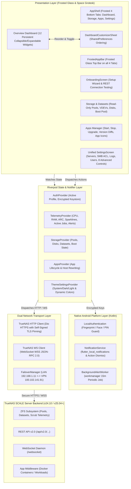

# NAS Dash System Architecture & Data Flow

This document provides a comprehensive blueprint of the **NAS Dash** (`com.ma.nasdash`) architecture, including layer-by-layer software structure, high-level Mermaid flowcharts, Riverpod state management pipelines, asynchronous background alert workers, frosted glass UI rendering with Space Grotesk, and storage safety guardrails.

---

## 1. High-Level System Architecture

NAS Dash is built with Flutter and Dart targeting Android. It follows a clean reactive architecture powered by `flutter_riverpod` (v2.x) for state management, `dio` with custom TLS adapters for secure REST APIs, `web_socket_channel` for real-time JSON-RPC 2.0 streaming, and `flutter_local_notifications` with `workmanager` for 24/7 background alert monitoring.

---

## 2. Navigation & Layer Division

1. **4 Primary Destinations in `AppShell` with Frosted Chrome**:
   - **Dashboard**: 12 modular widgets with header-tap collapse/expand controls (saved to `SharedPreferences`), numerical load gauges, compact `Row`-based RAM/ARC memory cards (`MemoryArcWidget`), and server alerts.
   - **Storage**: Read-only inspection of ZFS storage pools, VDEV RAID topologies, disk temperatures, hierarchical dataset tree, and OS boot pool wear & status.
   - **Apps**: Containerized application management with SVG and raster app icon rendering (`AppIconWidget` using `flutter_svg` and CDN fallback), side-by-side version upgrade diffs (`Current ➔ Update`), Start/Stop/Upgrade controls, and smart VPN portal host rewriting.
   - **Settings**: Unified control center with neutral monochrome icons (`colorScheme.onSurfaceVariant`), combining aligned server profile cards, instant SMB file share toggles with username-resolved Filesystem ACL inspection (`SmbAclBottomSheet`), System Logs & User Accounts (Host power history with formatted dates, Created user accounts), Advanced Controls & Telemetry sheets (Storage thresholds, Active jobs live monitor, Boot SSD health, App resources), and theme/notification controls.

2. **Theming, Typography & High-Performance Frosted Chrome**:
   - `google_fonts` (`Space Grotesk`) provides a crisp, technical aesthetic suited for system administrators.
   - Material You dynamic wallpaper color extraction (`dynamic_color`) adapts palettes automatically on Android 12+.
   - In-app ThemeMode switcher supports **System**, **Dark**, and **Light** modes.
   - Top and bottom navigation chrome use `FrostedAppBar` and blurred bottom navigation (`BackdropFilter` with `sigma: 18`) with `extendBodyBehindAppBar: true` and hardware-accelerated clipping for 120fps stutter-free scrolling.

3. **Storage & Data Safety**:
   - Dataset and pool deletion or modification is strictly barred from the UI.
   - Manual snapshot creation UI is removed to maintain a clean, read-only operational monitoring experience.

4. **Fail-Safe Startup Sequence & Icon Topology**:
   - Immediate `runApp()` launch inside `ProviderScope` prevents black screen freezes.
   - Global `FlutterError.onError`, `PlatformDispatcher.instance.onError`, and `ErrorWidget.builder` trap rendering and platform errors gracefully.
   - Adaptive launcher icon enlarged to 62% canvas scale on solid `#FFFFFF` white background with Android 13+ monochrome icon; status bar notification icon scaled to full-width 90% glyph in `drawable/ic_notification.png`.
   - `NotificationService.instance.requestPermissions()` is deferred to `WidgetsBinding.instance.addPostFrameCallback` in `AppShell` after the Android Activity mounts.
   - `FlutterSecureStorage` incorporates `resetOnError: true`, `encryptedSharedPreferences: true`, and a 4-second timeout to prevent KeyStore deadlocks.
   - Adaptive launcher icon foreground and monochrome silhouettes are sized strictly at **50% canvas scale** centered on solid `#FFFFFF` white across both `values` and `values-night` palettes.
